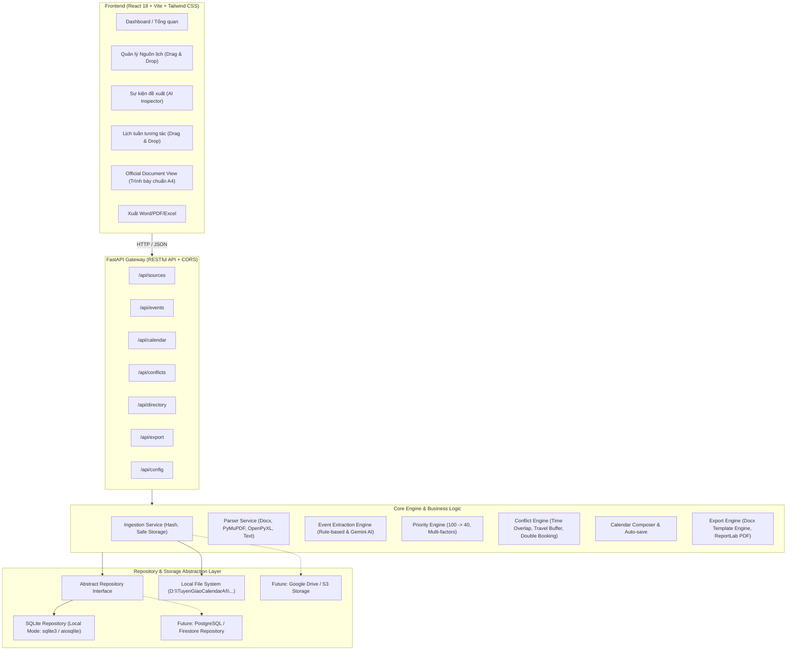

# TRỢ LÝ XÂY DỰNG LỊCH CÔNG TÁC AI
## TÀI LIỆU KIẾN TRÚC & ĐẶC TẢ THIẾT KẾ TOÀN DIỆN (CHUYÊN VIÊN VĂN PHÒNG SỐ)

---

### 1. KIẾN TRÚC HỆ THỐNG (SYSTEM ARCHITECTURE)

Hệ thống được thiết kế theo mô hình **Layered Architecture (Kiến trúc phân tầng)** kết hợp **Repository Pattern** nhằm đáp ứng yêu cầu:
- Chạy Local 100% trên Windows (Lưu tại `D:\TuyenGiaoCalendarAI\`).
- Có khả năng nâng cấp lên Online (Cloud/SaaS) mà không phải viết lại nghiệp vụ lõi (Domain Logic).



---

### 2. CẤU TRÚC THƯ MỤC CHUẨN (FOLDER STRUCTURE)

Hệ thống được tổ chức hoàn chỉnh tại ổ đĩa `D:\TuyenGiaoCalendarAI`:

```
D:\TuyenGiaoCalendarAI\
├── app\                                # Mã nguồn toàn bộ ứng dụng
│   ├── backend\                        # Backend Python FastAPI
│   │   ├── core\                       # Config, Logging, Security, Environment
│   │   ├── parsers\                    # Trình đọc tài liệu (DOCX, PDF, Excel, TXT)
│   │   ├── engines\                    # Bộ não nghiệp vụ:
│   │   │   ├── extractor.py            # Bóc tách sự kiện (Rule-based & AI Gemini)
│   │   │   ├── priority.py             # Tính toán trọng số ưu tiên
│   │   │   ├── conflict.py             # Thuật toán phát hiện xung đột & buffer di chuyển
│   │   │   └── preparation.py          # Bóc tách việc cần chuẩn bị
│   │   ├── repositories\               # Lớp truy cập CSDL (Repository Pattern)
│   │   ├── routers\                    # API Endpoints
│   │   ├── services\                   # Tích hợp dịch vụ & điều phối
│   │   ├── templates_engine\           # Xử lý điền vào file Word mẫu
│   │   └── main.py                     # Khởi chạy server FastAPI
│   └── frontend\                       # Giao diện React + Vite + Tailwind
│       ├── src\
│       │   ├── assets\
│       │   ├── components\             # UI components dùng chung (Card, Modal, Drawer, Table)
│       │   ├── pages\                  # Dashboard, Sources, Review, Calendar, Conflicts, Directory, Export, Settings
│       │   ├── services\               # API Client Axios
│       │   ├── store\                  # Quản lý State
│       │   └── App.jsx
│       ├── package.json
│       └── vite.config.js
├── data\                               # Dữ liệu cache, từ điển danh bạ nội bộ
├── uploads\                            # Lưu trữ file gốc người dùng tải lên (không ghi đè)
├── outputs\                            # File Word/PDF xuất ra (LICH_TUAN_XX_YYYY.docx)
├── templates\                          # Mẫu văn bản lịch chuẩn (.docx)
├── database\                           # File CSDL SQLite (calendar_ai.db)
├── backups\                            # Bản sao lưu SQLite tự động định kỳ
└── logs\                               # Log hoạt động hệ thống (audit, parse, ai, error)
```

---

### 3. THIẾT KẾ CƠ SỞ DỮ LIỆU SQLITE (SQLITE SCHEMA)

```sql
-- 1. Bảng lưu trữ nguồn tài liệu nhập vào
CREATE TABLE IF NOT EXISTS sources (
    id TEXT PRIMARY KEY,               -- UUID
    file_name TEXT NOT NULL,           -- Tên file gốc
    stored_path TEXT NOT NULL,         -- Đường dẫn lưu trữ trong uploads/
    source_type TEXT NOT NULL,         -- dang_uy, cap_tren, thu_moi_cap_tren, thong_bao_ke_hoach, co_so, chi_dao_khac, ghi_chu
    priority_level INTEGER NOT NULL,   -- 100, 95, 90, 85, 70, 60, 40 (hoặc custom)
    uploaded_at DATETIME NOT NULL,
    file_hash TEXT NOT NULL,           -- SHA-256 chống trùng lặp
    file_size INTEGER NOT NULL,
    parse_status TEXT NOT NULL,        -- NEW, PARSED, NEEDS_REVIEW, DONE, ERROR
    notes TEXT,
    raw_text TEXT                      -- Văn bản bóc tách thô
);

-- 2. Bảng danh bạ nhân sự & nhóm lãnh đạo
CREATE TABLE IF NOT EXISTS participants (
    id TEXT PRIMARY KEY,
    name TEXT NOT NULL,                -- Họ và tên
    title TEXT,                        -- Chức danh: Bí thư, Phó Bí thư, Chủ tịch UBND...
    unit TEXT,                         -- Cơ quan/Đơn vị
    group_name TEXT,                   -- Thường trực Đảng ủy, BTV, Lãnh đạo UBND, Văn phòng...
    aliases TEXT,                      -- JSON mảng các bí danh / cách gọi tắt
    location_default TEXT              -- Vị trí làm việc mặc định
);

-- 3. Bảng sự kiện lịch công tác (Events)
CREATE TABLE IF NOT EXISTS events (
    id TEXT PRIMARY KEY,
    source_id TEXT,                    -- FK tới sources
    source_document TEXT,              -- Tên văn bản nguồn
    source_page TEXT,                  -- Trang / Vị trí trích xuất
    source_paragraph TEXT,             -- Đoạn trích xuất đối soát

    event_date DATE NOT NULL,          -- Ngày diễn ra (YYYY-MM-DD)
    start_time TEXT NOT NULL,          -- Giờ bắt đầu (HH:MM)
    end_time TEXT,                     -- Giờ kết thúc (HH:MM hoặc NULL)
    
    title TEXT NOT NULL,               -- Tiêu đề ngắn gọn
    content TEXT NOT NULL,             -- Nội dung chi tiết cuộc họp/làm việc
    
    chair TEXT,                        -- Đồng chí chủ trì
    participants TEXT,                 -- Thành phần tham dự
    participant_group TEXT,            -- Nhóm tham gia chính (Thường trực, BTV...)
    
    location TEXT NOT NULL,            -- Địa điểm tổ chức
    organizer TEXT,                    -- Cơ quan/Đơn vị tổ chức
    
    preparation TEXT,                  -- Việc cần chuẩn bị (báo cáo, tài liệu...)
    documents_required TEXT,           -- Tài liệu mang theo
    contact_person TEXT,               -- Đầu mối liên hệ / Số điện thoại
    
    priority_score INTEGER NOT NULL,   -- Điểm ưu tiên tính toán (0 - 100)
    confidence REAL NOT NULL,          -- Độ tin cậy trích xuất (0.0 - 1.0)
    
    status TEXT NOT NULL,              -- PROPOSED, APPROVED, REJECTED, CONFLICT, CONFIRMED
    missing_data_fields TEXT,          -- JSON mảng các trường thiếu: ["end_time", "chair"]
    
    created_at DATETIME NOT NULL,
    updated_at DATETIME NOT NULL,
    FOREIGN KEY(source_id) REFERENCES sources(id)
);

-- 4. Bảng phát hiện xung đột lịch (Conflicts)
CREATE TABLE IF NOT EXISTS conflicts (
    id TEXT PRIMARY KEY,
    event_id_1 TEXT NOT NULL,
    event_id_2 TEXT NOT NULL,
    conflict_type TEXT NOT NULL,       -- OVERLAP_TIME, SAME_PERSON_DIFFERENT_LOC, TRAVEL_BUFFER_VIOLATION, PRIORITY_OVERRIDE
    severity TEXT NOT NULL,            -- CONFLICT HIGH, CONFLICT MEDIUM, WARNING
    description TEXT NOT NULL,
    resolution_suggestion TEXT,        -- Đề xuất xử lý của AI
    status TEXT DEFAULT 'OPEN',        -- OPEN, RESOLVED, IGNORED
    created_at DATETIME NOT NULL,
    FOREIGN KEY(event_id_1) REFERENCES events(id),
    FOREIGN KEY(event_id_2) REFERENCES events(id)
);

-- 5. Bảng cấu hình hệ thống (Settings)
CREATE TABLE IF NOT EXISTS settings (
    key TEXT PRIMARY KEY,
    value TEXT NOT NULL,
    description TEXT
);

-- 6. Bảng nhật ký kiểm toán (Audit Logs)
CREATE TABLE IF NOT EXISTS system_logs (
    id INTEGER PRIMARY KEY AUTOINCREMENT,
    action TEXT NOT NULL,              -- IMPORT, PARSE, AI_CALL, EVENT_CREATE, EVENT_EDIT, EXPORT, ERROR
    details TEXT,
    created_at DATETIME NOT NULL
);
```

---

### 4. BỘ QUY TẮC TÍNH ĐIỂM ƯU TIÊN (PRIORITY RULES)

Điểm ưu tiên của sự kiện ($P_{event}$) được tính toán theo công thức tường minh, không để AI suy diễn cảm tính:

$$P_{event} = 0.50 \times S_{priority} + 0.25 \times M_{mandatory} + 0.15 \times L_{leader} + 0.10 \times T_{sensitivity}$$

Trong đó:
1. **$S_{priority}$ (Nguồn phát hành):**
   - Lịch Đảng ủy phường: `100`
   - Lịch cấp trên (Quận/Thành ủy): `95`
   - Thư mời cấp trên: `90`
   - Thông báo / Kế hoạch cấp trên: `85`
   - Thư mời cấp cơ sở (Khu phố/Đoàn thể): `70`
   - Nội dung chỉ đạo khác: `60`
   - Ghi chú nội bộ: `40`
2. **$M_{mandatory}$ (Mức độ bắt buộc):**
   - Có từ khóa: "Triệu tập", "Bắt buộc", "Chỉ đạo trực tiếp" $\rightarrow$ `100`
   - "Kính mời dự", "Mời họp" $\rightarrow$ `80`
   - "Phân công dự", "Cử đại diện" $\rightarrow$ `60`
   - "Dự nếu có điều kiện", "Tùy chọn" $\rightarrow$ `30`
3. **$L_{leader}$ (Cấp bậc người chủ trì / tham dự):**
   - Bí thư Đảng ủy, Chủ tịch UBND $\rightarrow$ `100`
   - Phó Bí thư, Phó Chủ tịch UBND $\rightarrow$ `85`
   - Ủy viên BTV, Trưởng các ban ngành $\rightarrow$ `70`
   - Chuyên viên, đại diện bộ phận $\rightarrow$ `50`
4. **$T_{sensitivity}$ (Tính nhạy cảm thời gian):**
   - Họp đột xuất, khẩn $\rightarrow$ `100`
   - Định kỳ tuần/tháng $\rightarrow$ `60`

---

### 5. BỘ QUY TẮC XUNG ĐỘT & TRAVEL BUFFER (CONFLICT ENGINE)

| Loại xung đột | Điều kiện phát hiện | Mức độ cảnh báo | Đề xuất của trợ lý |
|---|---|---|---|
| **Trùng giờ tuyệt đối** | Hai sự kiện cùng ngày, cùng khung giờ $(t_{1\_start} \le t_{2\_end} \land t_{2\_start} \le t_{1\_end})$ và có chung nhân sự/chủ trì | `CONFLICT HIGH` | Giữ sự kiện có $P_{event}$ cao hơn; đề xuất cử cấp phó hoặc dời giờ sự kiện thấp hơn |
| **Thiếu thời gian di chuyển (Travel Buffer)** | Khoảng cách thời gian $\Delta t < Buffer_{req}$ giữa 2 địa điểm khác nhau | `CONFLICT HIGH` hoặc `MEDIUM` | Cảnh báo không kịp di chuyển; gợi ý thời gian xuất phát |
| **Lịch ưu tiên thấp đè lịch ưu tiên cao** | Sự kiện có priority thấp được xếp chèn vào giờ sự kiện cấp trên | `WARNING` | Yêu cầu chuyên viên xác nhận có hoãn sự kiện cấp dưới hay không |

**Cấu hình Buffer di chuyển cục bộ (Local Settings):**
- Cùng tòa nhà/trụ sở: **5 phút**
- Cùng phường: **15 phút**
- Khác phường / cùng quận/huyện/thành phố: **30 phút**
- Ngoại tỉnh / khu vực xa: **60 phút**

---

### 6. EVENT EXTRACTION SCHEMA & TRACEABILITY CONTRACT

Mọi sự kiện khi bóc tách phải tuân thủ JSON Contract nghiêm ngặt:
```json
{
  "source_trace": {
    "file_name": "Lich_Hop_Quan_Uy_Tuan_43.docx",
    "document_number": "145-GM/QU",
    "page": 1,
    "paragraph": "Mục 2: Chiều Thứ Ba, 14:00..."
  },
  "event_date": "2026-10-27",
  "start_time": "14:00",
  "end_time": "16:30",
  "title": "Hội nghị Ban Thường vụ Quận ủy",
  "content": "Đánh giá công tác xây dựng Đảng tháng 10 và định hướng nhiệm vụ tháng 11.",
  "chair": "Đ/c Bí thư Quận ủy",
  "participants": "Thường trực Quận ủy, Bí thư Đảng ủy 12 phường",
  "participant_group": "Thường trực Đảng ủy",
  "location": "Phòng họp số 1, Trụ sở Quận ủy",
  "organizer": "Văn phòng Quận ủy",
  "preparation": "Báo cáo tóm tắt tình hình cơ sở theo Đề cương số 12",
  "documents_required": "Tài liệu gửi kèm file PDF số 145",
  "contact_person": "Đ/c Nam - CV VP Quận ủy (0912.xxx.xxx)",
  "confidence": 0.95,
  "missing_data_fields": []
}
```
*Nguyên tắc:* Nếu bất kỳ trường nào không có trong tài liệu, đánh dấu `MISSING_DATA` trong `missing_data_fields`, tuyệt đối không tự bịa đặt.

---

### 7. THIẾT KẾ XUẤT BẢN LỊCH CHÍNH THỨC (EXPORT DESIGN)

1. **Khổ chuẩn A4 & Font chữ hành chính:**
   - Font Times New Roman hoặc Arial, size 12-13pt.
   - Bố cục 2 phần: Tiêu ngữ, Tên cơ quan, Tên văn bản `LỊCH CÔNG TÁC TUẦN ... (Từ ngày ... đến ngày ...)`.
2. **Khung hiển thị Thứ Hai $\rightarrow$ Chủ Nhật:**
   - Buổi Sáng (Bắt đầu từ 07:30 / 08:00)
   - Buổi Chiều (Bắt đầu từ 13:30 / 14:00)
   - Tối (nếu có sự kiện)
   - Bóc rõ 4 dòng thông tin bắt buộc: **Nội dung - Chủ trì - Thành phần - Địa điểm - Chuẩn bị**.
3. **Giữ nguyên Template Word người dùng tải lên:**
   - Dùng thư viện `python-docx` để thay thế token giữ nguyên header/footer/logo của đơn vị.

---

### 8. LỘ TRÌNH TRIỂN KHAI THEO CÁC PHASE

- [x] **Khởi tạo:** Tạo thư mục lưu trữ `D:\TuyenGiaoCalendarAI\` và các thư mục con.
- [ ] **Phase 1 (Đang triển khai ngay):**
  - Cấu trúc Backend FastAPI & Database SQLite với Repository Pattern.
  - Bộ đọc tài liệu đa định dạng (DOCX, PDF, Excel, TXT, Nhập thủ công).
  - Trích xuất sự kiện kết hợp Rule-based Regex và AI Engine.
  - Giao diện React + Tailwind hiện đại: Dashboard, Upload nguồn, Review sự kiện.
- [ ] **Phase 2:**
  - Priority Engine & Conflict Engine với Travel Buffer.
  - Danh bạ nhân sự / Nhóm lãnh đạo (Thường trực, BTV, UBND).
  - Lịch tuần tương tác (Week Calendar Drag & Drop).
- [ ] **Phase 3:**
  - Official Schedule Document View (Xem trực quan dạng văn bản A4).
  - Công cụ xuất file Word (`.docx`), PDF (`.pdf`), Excel (`.xlsx`).
- [ ] **Phase 4 & 5:**
  - Trích xuất việc cần chuẩn bị nâng cao.
  - Lớp trừu tượng sẵn sàng chuyển đổi Cloud/Online.
